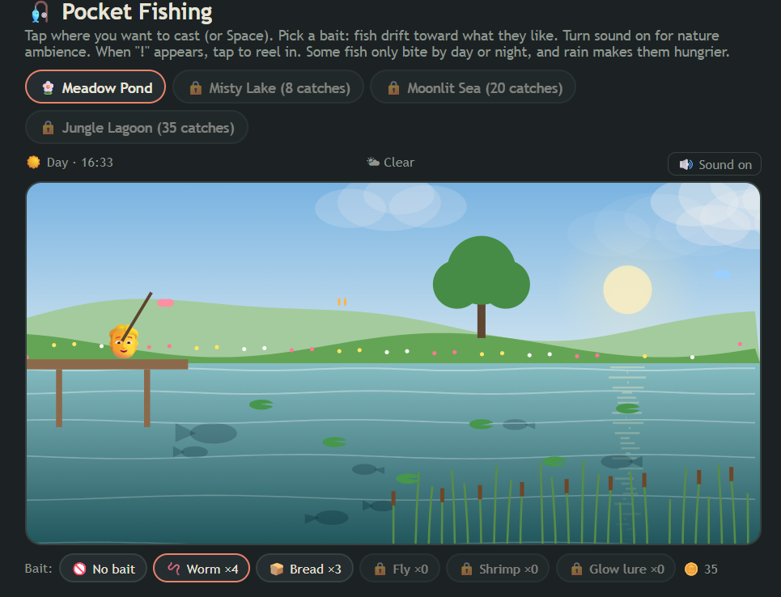
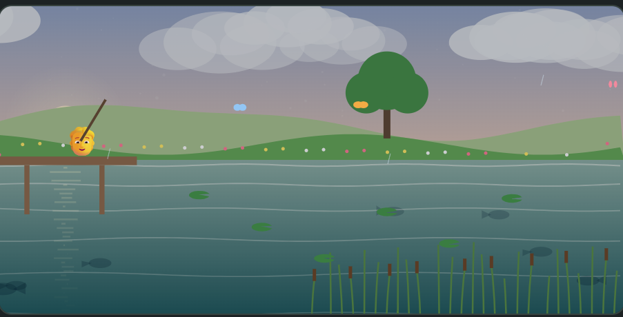
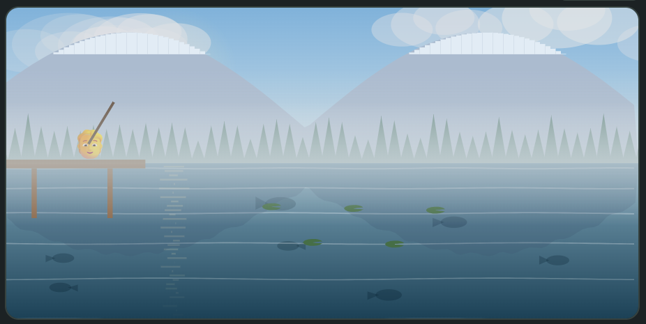
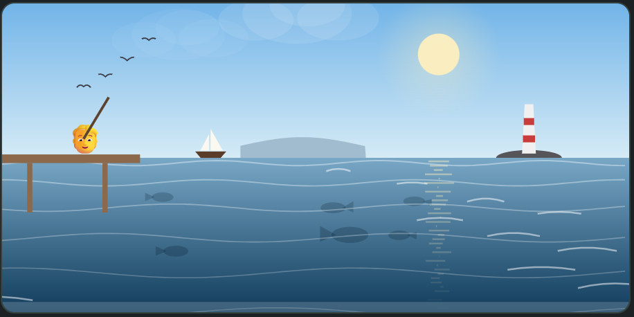
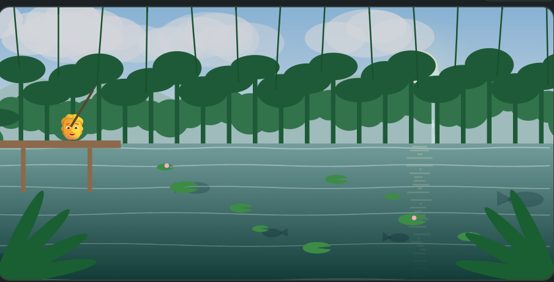
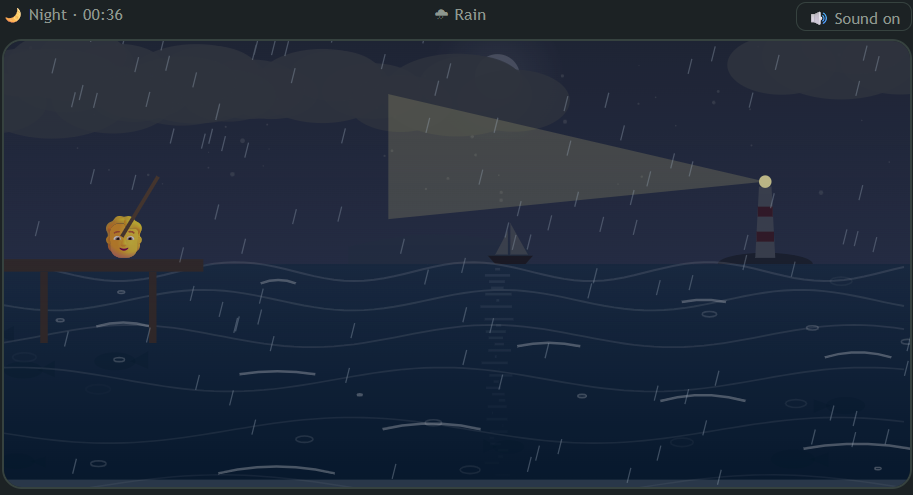
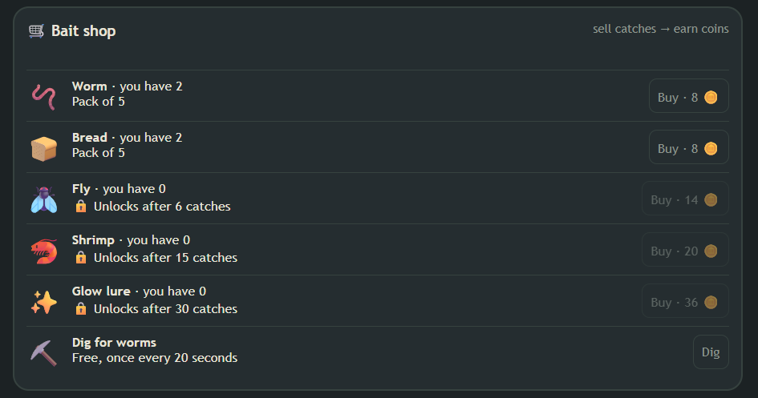
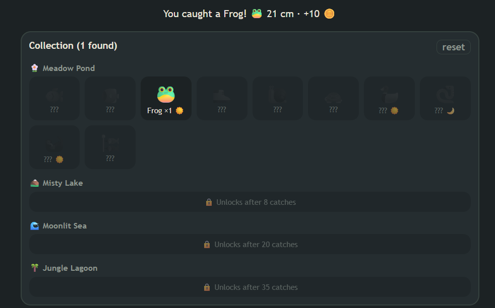
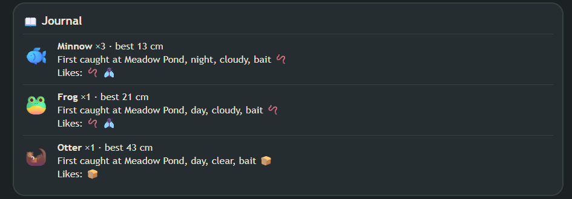

# 🎣 Pocket Fishing

A cozy, relaxing browser fishing game. No install, no dependencies: just open `index.html`.

**Play it:** https://musabbirrahman.github.io/pocket-fishing/

## How to play
Tap where you want to cast. When the bobber dips and "!" appears, tap again to reel in.
Pick a bait first: fish drift toward the bait they like. Turn on sound with the 🔊 button.

## Ponds
Each pond has its own scenery, fish and water behavior.

| Meadow Pond | Misty Lake |
|---|---|
|  |  |
| Rolling hills, flowers, butterflies and reeds. | Snowy mountains, pines, mist and calm water. Fish swim slower. |

| Moonlit Sea | Jungle Lagoon |
|---|---|
|  |  |
| Lighthouse, sailboat, gulls and big waves. Fish are faster. | Dense canopy, waterfall, lily pads and fireflies at night. |

Ponds unlock as you catch more fish. Two newer ponds, Alpine Tarn and Frozen Pond, come later in the game.

## Day, night and weather
A full day passes in about 2.5 minutes, and the weather drifts between clear, cloudy, rain and fog. Some fish only bite by day or night, and rain makes fish bite sooner.

## Bait and the shop
Each cast uses one bait. Sell catches for coins, then buy bait packs. Better baits unlock as you catch more. If you run out, fish with no bait or use the free worm dig.

## Collection and journal
Fill your collection book with every fish. The journal records your biggest catch, where and when you first caught each fish, and which baits it likes.

## Features
- 6 ponds with 70 collectibles, including an alpine lake and a frozen ice-fishing pond
- Rod upgrades, 23 gentle achievements, a unique fish in every pond and an in-game fish guide
- Fish that swim, notice bait, nibble and bite
- Cast, bobber and reeling physics
- Day/night cycle and changing weather
- Bait economy with coins and unlockable baits
- Ambient nature sounds for each pond
- Progress saved in your browser (localStorage)

## Run locally
Open `index.html` in any modern browser.
